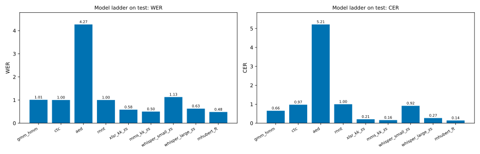
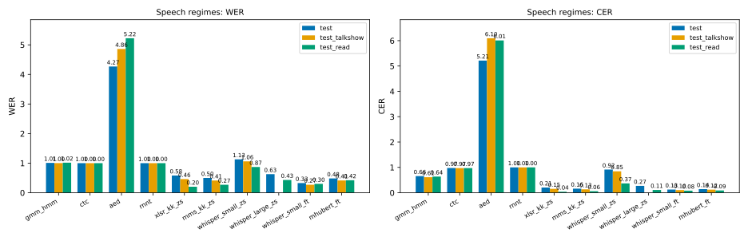
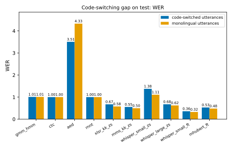
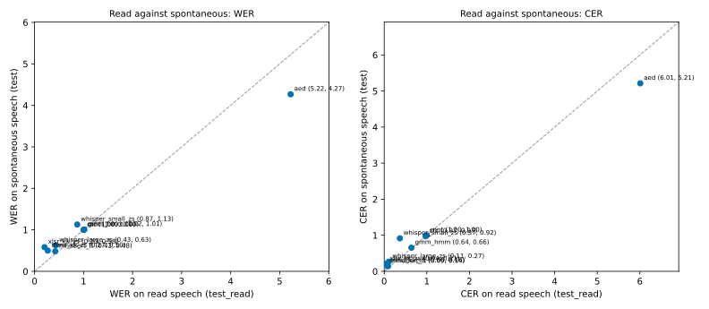

# Aralas

Speech recognition for spontaneous Kazakh with Kazakh-Russian code-switching: a podcast, radio or talk show segment is transcribed in Cyrillic, with Kazakh words in Kazakh and Russian words in Russian.

## Summary

| | |
|---|---|
| Task | ASR: a 0.5–30 s audio segment → its Cyrillic transcript |
| Language | Kazakh (kk), with Russian words and Russian stems inside Kazakh sentences |
| Data | ISSAI KSC2, spontaneous part (podcasts, radio, talk show) + the KSC read-speech test set; human transcripts, re-split by program |
| Train | 22811 utterances, 31.079 h (`data/processed/stats.json`) |
| Test regimes | `test` (spontaneous podcasts), `test_talkshow` (a talk show program never seen in training), `test_read` (read speech) |
| Models | 4 published models without training, 4 models trained by us from scratch (GMM-HMM, CTC, attention encoder-decoder, RNN-T), 2 fine-tuned models (our contribution) |
| Main metric | corpus-level WER on normalized text; CER and code-switching metrics alongside |
| Best test WER | `mhubert_ft` 0.4832 (`results/benchmark.csv`) |

## Why this project is new

- **Task.** Kazakh speakers switch to Russian in the middle of a sentence ("в общем ұнады ғой маған", "overall, I liked it"), and Russian stems take Kazakh suffixes ("составтың", "of the squad"). Models trained on read Kazakh break down on this. We measure how much, and how much fine-tuning on spontaneous speech recovers.
- **Data.** We do not use the official KSC2 splits, because they do not keep speakers apart. We re-split the spontaneous part of KSC2 by program and add a code-switching tag to every reference word. No reference is written or edited by us.

Research questions:

1. **RQ1, read to spontaneous.** How much worse do the course baselines get from the KSC read-speech test set to spontaneous speech?
2. **RQ2, code-switching.** How much worse is the same model on code-switched utterances than on monolingual ones, and how many Russian words does it recognize?
3. **RQ3, contribution.** How much does fine-tuning on our spontaneous train split close these gaps, including on a program never seen in training (the talk show)?

## The task

Input: one segment of a podcast, radio or talk show recording, 16 kHz mono. Output: its transcript in lowercase Cyrillic, scored after one fixed text normalization. One code-switched dev reference (`podcasts_02_02_17`) with its word tags:

| word | в | общем | ұнады | ғой | маған |
|---|---|---|---|---|---|
| tag | amb | ru | kz | kz | kz |

## Dataset

The full description, with the source of every number, is in [`docs/preprocessing.md`](docs/preprocessing.md). In short:

- **Sources.** ISSAI KSC2 (Mussakhojayeva, Khassanov and Varol, Interspeech 2022): the `podcasts`, `radio` and `talkshow` folders and the KSC v1.1 read test set (`Test/crowdsourced`). Transcripts were made by native Kazakh and Russian transcribers of ISSAI. `data/raw/` keeps the original transcripts and the audio as 16 kHz mono Opus; `data/processed/` keeps the cleaned manifests.
- **Why not the official splits.** KSC2 has no speaker labels, and its paper states that speaker separation between its splits "is not fully guaranteed". Following the course rule for corpora without speaker IDs, we group by the closest unit, the **program**: all episodes of a program, and therefore its hosts, stay in one split. The podcast split of KSC2 is already disjoint by program and is used as is. Radio is one program and goes entirely to train; the talk show is one program and goes entirely to `test_talkshow`.
- **Leakage** (`stats.json`, `leakage`): 0 programs and 0 episodes are in more than one split. Dev or test utterances whose text occurs verbatim in train: 4 before cleaning (2 with at least 4 words), 1 after cleaning (0 with at least 4 words).
- **Cleaning** (`scripts/clean_dataset.py`, rules C1–C9). Every removed utterance is logged in `data/processed/cleaning_log.csv` with the measured value and the threshold. 603 utterances were removed in total (`stats.json`, `removed_total`): C1 broken audio 1, C4 speaking-rate outliers 220, C5 clipping 378, C9 train text that equals a dev or test text 4 (`removed_per_rule`).
- **Normalization** (`src/data_io.normalize_text`, the only text policy, applied to references and hypotheses alike): lowercase; ё → е; digits → Kazakh number words; drop bracketed spans; dashes → space; characters outside the 42-character alphabet (`data_io.CHARS`) → space; drop hesitation tokens (ы+, і+, м+, мхм, хм, э+); collapse spaces. It removed 12666 hesitation tokens (`stats.json`).
- **Code-switching tags** (`src/codeswitch.py`): each reference word is `kz`, `ru`, `mix` (Russian stem with Kazakh suffixes) or `amb`; an utterance is code-switched if it has a `kz` word and a `ru` or `mix` word. The Kazakh lexicon has 111372 words and the Russian lexicon 7559 (`stats.json`, `lexicon_sizes`). A hand audit of all code-switched dev utterances is reported in `docs/preprocessing.md`.

Statistics per split (`stats.json`, `splits`). We report programs and episodes instead of speakers because the corpus has no speaker labels.

| split | utterances | hours | programs | episodes | words | code-switched utterances | cs rate | ru words | mix words |
|---|---|---|---|---|---|---|---|---|---|
| train | 22811 | 31.079 | 7 | 78 | 221716 | 1301 | 0.057 | 2483 | 210 |
| dev | 1081 | 1.85 | 2 | 8 | 14100 | 57 | 0.0527 | 72 | 7 |
| test | 1546 | 2.885 | 1 | 5 | 20428 | 95 | 0.0614 | 114 | 20 |
| test_talkshow | 4368 | 6.798 | 1 | 9 | 50659 | 329 | 0.0753 | 478 | 57 |
| test_read | 3327 | 7.031 | 1 | 1 | 35691 | 12 | 0.0036 | 15 | 2 |

The listening check of `scripts/listen_qc.py` (rule C8) was planned after the data freeze at tag `data-v1`; `results/human_qc.csv` is not part of this release, so C8 removed nothing.

## Course baselines and our implementation

| baseline named in the course | our run | architecture · checkpoint @ revision | trained by us | supports Kazakh |
|---|---|---|---|---|
| GMM-HMM | `gmm_hmm` (`src/gmm_hmm.py`) | 3-state character HMMs with GMM emissions on MFCCs, Viterbi training, character bigram LM | yes, from scratch | yes |
| wav2vec 2.0 + CTC fine-tuned for the language | `xlsr_kk_zs` (`src/eval_zero_shot.py`) | wav2vec 2.0 XLSR-53 + CTC · [`aismlv/wav2vec2-large-xlsr-kazakh`](https://huggingface.co/aismlv/wav2vec2-large-xlsr-kazakh) @ `b277ef85de7bbd28302d570062feb196cc4e9107` | no | yes (fine-tuned on KSC v1.1 train) |
| wav2vec 2.0 + CTC (second model) | `mms_kk_zs` | wav2vec 2.0 MMS-1B + `kaz` adapter · [`facebook/mms-1b-all`](https://huggingface.co/facebook/mms-1b-all) @ `3d33597edbdaaba14a8e858e2c8caa76e3cec0cd` | no | yes |
| HuBERT + CTC fine-tuned for the language | `mhubert_ft` (our contribution, below) | no Kazakh HuBERT ASR checkpoint is published on Hugging Face, so we fine-tune one | yes | yes |
| Whisper, multilingual | `whisper_small_zs`, `whisper_large_zs` | Transformer encoder-decoder · [`openai/whisper-small`](https://huggingface.co/openai/whisper-small) @ `973afd24965f72e36ca33b3055d56a652f456b4d`, [`openai/whisper-large-v3`](https://huggingface.co/openai/whisper-large-v3) @ `06f233fe06e710322aca913c1bc4249a0d71fce1`, `language="kk"` | no | yes |
| Canary | not run | [`nvidia/canary-1b-v2`](https://huggingface.co/nvidia/canary-1b-v2): the model card lists 25 European languages, not Kazakh | – | no |
| Parakeet | not run | [`nvidia/parakeet-tdt-0.6b-v3`](https://huggingface.co/nvidia/parakeet-tdt-0.6b-v3): the same 25 languages, not Kazakh | – | no |
| Qwen3-ASR | not run | [`Qwen/Qwen3-ASR-1.7B`](https://huggingface.co/Qwen/Qwen3-ASR-1.7B): the model card lists 30 languages and 22 Chinese dialects, not Kazakh | – | no |

We also train three end-to-end baselines from scratch that share one encoder and differ only in how they align audio frames with characters: `ctc` (CTC), `aed` (attention encoder-decoder) and `rnnt` (RNN transducer).

## Models and training settings

Every setting below is stored in the `config` field of the run file `results/<model>_seed<seed>.json`, together with the checkpoint, revision, hardware, training time and parameter count.

- **Zero-shot** (`src/eval_zero_shot.py`, seed 0): greedy decoding, fp16 on GPU. Whisper gets `language="kk"` and `task="transcribe"`.
- **GMM-HMM** (`src/gmm_hmm.py`): MFCC with deltas, per-utterance normalization; language-model weight and insertion penalty chosen on dev.
- **From scratch** (`src/models.py`, `src/train_scratch.py`): log-mel features (80 bands, 25 ms window, 10 ms hop), speed perturbation with noise and SpecAugment. The shared encoder has two stride-2 convolutions and a 4-layer bidirectional LSTM. Heads: `ctc` linear + CTC; `aed` LSTM decoder with additive attention; `rnnt` LSTM prediction network + joint network. Early stopping on dev WER. Because of the compute budget, each run had a time limit (`config.max_minutes`), and `aed` and `rnnt` have one seed (team cut-off decision).
- **`whisper_small_ft`** (`src/train_whisper.py`, our contribution): full fine-tuning of `openai/whisper-small` on our train split, Kazakh transcription prefix, fp16 autocast, effective batch 16, 5 epochs, best epoch by dev WER. The learning rate was chosen on dev among 5e-6, 1e-5 and 3e-5 (one epoch, seed 42); 3e-5 was selected.
- **`mhubert_ft`** (`src/train_mhubert.py`, our contribution): HuBERT base, [`utter-project/mHuBERT-147`](https://huggingface.co/utter-project/mHuBERT-147) @ `7ad3fc0bc5106c58c9c13526abccad527150d135` (its pre-training data includes Kazakh), with a new CTC head over our 42 characters; the convolutional feature encoder is frozen; greedy CTC decoding.
- **Seeds**: 13, 42 and 2026 for trained models, 0 for zero-shot models.

## Evaluation

### Why WER and CER, and why normalized

We follow the [Hugging Face Audio Course, chapter 5](https://huggingface.co/learn/audio-course/en/chapter5/evaluation).

- **WER is the main metric**: (substitutions + deletions + insertions) / number of reference words, computed at corpus level with `jiwer` in `src/metrics.py`. It is the standard ASR metric of the course and of the KSC2 paper, so our numbers can be compared with the literature. It can exceed 1 when a system inserts many words.
- **CER is reported next to it.** The course notes that CER penalizes a spelling error much less than WER. Kazakh is agglutinative: one wrong suffix makes the whole word wrong for WER, while CER shows that most of the word was right. CER also separates systems whose WER is saturated near 1.
- **Normalized text.** The course distinguishes orthographic from normalized WER and recommends evaluating on normalized text. KSC2 references are already lowercase without punctuation; scoring raw output would penalize systems that produce capitals and punctuation (Whisper) for something the references do not contain. One normalization (`data_io.normalize_text`, above) is applied identically to references and hypotheses, and only `src/metrics.py` computes scores.

### Code-switching metrics

- `cs_wer` / `mono_wer`: WER on code-switched utterances only / on the remaining utterances only.
- `ru_word_acc`: the share of reference words tagged `ru` or `mix` that the alignment marks as correct. Overall WER hides the loss of a few Russian words in a sentence; this metric measures it directly.
- `kz_word_acc`: the same for words tagged `kz`.

### Protocol

- All choices (epochs, learning rates, the GMM-HMM language-model weight and insertion penalty) are made on dev. The test splits are read only by scripts run with `--final`.
- Final splits evaluated: `dev`, `test`, `test_talkshow`, `test_read`.
- Uncertainty: mean ± population standard deviation over seeds, and a 95 % bootstrap confidence interval that resamples utterances (1000 resamples, seed 0) and pools the seeds.
- Significance: a paired bootstrap between neighbours on the model ladder, on the same resampled utterances (a simple form of the MAPSSWE test named in the course). The table below reports the probability that a model has a lower WER than the model it is compared with.
- `build_benchmark.py` rescores every run from `results/preds/` and stops if any stored number differs.

## Results

All numbers in this section are rows of `results/benchmark.csv` and `results/ablations.csv`, built with `python -m src.build_benchmark --final`. "KSC in training" is the `contamination` column: `yes` only where the model card says the model was trained on KSC (then `test_read` is not a fair test for it), `unknown` where the card does not say.

### Baselines without training (seed 0)

| model | split | WER | WER 95 % CI | CER | cs_WER | mono_WER | ru_word_acc | KSC in training |
|---|---|---|---|---|---|---|---|---|
| xlsr_kk_zs | test | 0.5831 | 0.5726-0.5941 | 0.2058 | 0.6737 | 0.5758 | 0.0448 | no |
| xlsr_kk_zs | test_talkshow | 0.4616 | 0.4547-0.4689 | 0.1530 | 0.5882 | 0.4494 | 0.0449 | no |
| xlsr_kk_zs | test_read | 0.2032 | 0.1975-0.2086 | 0.0404 | 0.4211 | 0.2020 | 0.1765 | yes |
| mms_kk_zs | test | 0.5002 | 0.4895-0.5120 | 0.1607 | 0.5539 | 0.4959 | 0.1418 | unknown |
| mms_kk_zs | test_talkshow | 0.4139 | 0.4076-0.4210 | 0.1331 | 0.5031 | 0.4053 | 0.1589 | unknown |
| mms_kk_zs | test_read | 0.2690 | 0.2627-0.2752 | 0.0594 | 0.4368 | 0.2681 | 0.4118 | unknown |
| whisper_small_zs | test | 1.1285 | 1.0746-1.1903 | 0.9155 | 1.3750 | 1.1087 | 0.0522 | unknown |
| whisper_small_zs | test_talkshow | 1.0610 | 1.0265-1.0963 | 0.8452 | 1.1614 | 1.0513 | 0.0467 | unknown |
| whisper_small_zs | test_read | 0.8703 | 0.8468-0.8983 | 0.3680 | 1.3211 | 0.8679 | 0.2353 | unknown |
| whisper_large_zs | test | 0.6271 | 0.6093-0.6480 | 0.2697 | 0.6750 | 0.6233 | 0.1791 | unknown |
| whisper_large_zs | test_read | 0.4318 | 0.4194-0.4476 | 0.1089 | 0.5368 | 0.4313 | 0.4118 | unknown |

`whisper_large_zs` was run on `test` and `test_read` only; it has no `dev` or `test_talkshow` scores.

### Baselines trained by us

| model | split | WER (mean ± std) | WER 95 % CI | CER | cs_WER | mono_WER | seeds |
|---|---|---|---|---|---|---|---|
| gmm_hmm | test | 1.0091 ± 0.0040 | 1.0065-1.0118 | 0.6555 | 1.0090 | 1.0091 | 3 |
| gmm_hmm | test_talkshow | 1.0021 ± 0.0026 | 1.0005-1.0037 | 0.6124 | 0.9994 | 1.0023 | 3 |
| gmm_hmm | test_read | 1.0159 ± 0.0084 | 1.0139-1.0180 | 0.6381 | 1.0158 | 1.0159 | 3 |
| ctc | test | 1.0000 ± 0.0000 | 1.0000-1.0000 | 0.9746 | 1.0000 | 1.0000 | 3 |
| ctc | test_talkshow | 1.0000 ± 0.0000 | 0.9999-1.0000 | 0.9706 | 0.9999 | 1.0000 | 3 |
| ctc | test_read | 1.0000 ± 0.0000 | 1.0000-1.0000 | 0.9713 | 1.0000 | 1.0000 | 3 |
| aed | test | 4.2676 | 4.1645-4.3650 | 5.2135 | 3.5053 | 4.3289 | 1 |
| aed | test_talkshow | 4.8598 | 4.7948-4.9295 | 6.0952 | 4.1382 | 4.9294 | 1 |
| aed | test_read | 5.2231 | 5.1493-5.3020 | 6.0096 | 3.5368 | 5.2322 | 1 |
| rnnt | test | 1.0000 | 1.0000-1.0000 | 1.0000 | 1.0000 | 1.0000 | 1 |
| rnnt | test_talkshow | 1.0000 | 1.0000-1.0000 | 1.0000 | 1.0000 | 1.0000 | 1 |
| rnnt | test_read | 1.0000 | 1.0000-1.0000 | 1.0000 | 1.0000 | 1.0000 | 1 |

`ru_word_acc` is 0.0000 for all four on every split. Within our compute budget none of these models learned to write correct words: `ctc` and `rnnt` output almost or entirely empty transcripts (WER 1), `gmm_hmm` outputs character strings that rarely form a correct word, and `aed` loops until its length limit (WER far above 1 from insertions). They are course baselines that show how far each alignment method gets from 31.079 hours of training data without pre-training, not competitive systems.

### Our contributions

| model | split | WER (mean ± std) | WER 95 % CI | CER | cs_WER | mono_WER | ru_word_acc | seeds | KSC in training |
|---|---|---|---|---|---|---|---|---|---|
| mhubert_ft | test | 0.4832 | 0.4737-0.4926 | 0.1414 | 0.5296 | 0.4794 | 0.1045 | 1 | unknown |
| mhubert_ft | test_talkshow | 0.4148 | 0.4079-0.4217 | 0.1210 | 0.5049 | 0.4061 | 0.1234 | 1 | unknown |
| mhubert_ft | test_read | 0.4224 | 0.4152-0.4288 | 0.0890 | 0.5263 | 0.4218 | 0.0588 | 1 | unknown |

`whisper_small_ft` seed 42 is still running at the time of writing; its rows are added from `results/benchmark.csv` when the run file arrives.

### Dev

| model | dev WER | dev CER |
|---|---|---|
| gmm_hmm | 1.0103 | 0.6369 |
| ctc | 1.0000 | 0.9734 |
| aed | 4.3106 | 5.2385 |
| rnnt | 1.0000 | 1.0000 |
| xlsr_kk_zs | 0.5948 | 0.2103 |
| mms_kk_zs | 0.5119 | 0.1715 |
| whisper_small_zs | 1.2069 | 0.9506 |
| mhubert_ft | 0.5027 | 0.1538 |

### Significance (paired bootstrap, `p_lower_wer`)

Probability that the first model has a lower WER than the second, on the same resampled utterances.

| model | compared with | test | test_talkshow | test_read |
|---|---|---|---|---|
| mhubert_ft | whisper_large_zs | 1.000 | – | 0.908 |
| whisper_large_zs | whisper_small_zs | 1.000 | – | 1.000 |
| whisper_small_zs | mms_kk_zs | 0.000 | 0.000 | 0.000 |
| mms_kk_zs | xlsr_kk_zs | 1.000 | 1.000 | 0.000 |
| xlsr_kk_zs | rnnt | 1.000 | 1.000 | 1.000 |
| rnnt | aed | 1.000 | 1.000 | 1.000 |
| aed | ctc | 0.000 | 0.000 | 0.000 |
| ctc | gmm_hmm | 1.000 | 0.997 | 1.000 |

### Ablations (`results/ablations.csv`, seed 42)

| model | split | WER | CER | ΔWER vs ctc |
|---|---|---|---|---|
| ctc-mfcc | dev | 1.0000 | 1.0000 | 0.0000 |
| ctc-mfcc | test | 1.0000 | 1.0000 | 0.0000 |
| ctc-mfcc | test_talkshow | 1.0000 | 1.0000 | 0.0000 |
| ctc-mfcc | test_read | 1.0000 | 1.0000 | 0.0000 |
| ctc-noaug | dev | 0.9992 | 0.6895 | -0.0008 |
| ctc-noaug | test | 0.9996 | 0.7003 | -0.0004 |
| ctc-noaug | test_talkshow | 0.9994 | 0.6822 | -0.0006 |
| ctc-noaug | test_read | 1.0002 | 0.7153 | 0.0002 |

`ctc` itself has dev CER 0.9734 and test CER 0.9746 (mean of 3 seeds). Without augmentation, CER is clearly lower within the same budget, which suggests that augmentation slowed early learning; with MFCC features the model produced no correct characters. WER stays near 1 for all three.

### Figures

| | |
|---|---|
|  |  |
|  |  |

### Answers to the research questions

- **RQ1, read to spontaneous.** Every pretrained baseline is worse on spontaneous `test` than on `test_read`: `mms_kk_zs` 0.2690 → 0.5002, `whisper_large_zs` 0.4318 → 0.6271, `whisper_small_zs` 0.8703 → 1.1285, `xlsr_kk_zs` 0.2032 → 0.5831 (its `test_read` is contaminated: it was fine-tuned on KSC train).
- **RQ2, code-switching.** `cs_wer` is above `mono_wer` for every pretrained baseline and for `mhubert_ft` on every test split they were run on, and Russian words are rarely recognized: `ru_word_acc` on `test` is 0.0448 to 0.1791 for the pretrained baselines and 0.1045 for `mhubert_ft`.
- **RQ3, contribution.** `mhubert_ft` has the lowest WER on `test` (0.4832), ahead of `whisper_large_zs` with probability 1.000 in the paired bootstrap. On the unseen talk show program it reaches 0.4148, about the same as `mms_kk_zs` (0.4139). Fine-tuning closes much of the read-to-spontaneous gap (`test` 0.4832 against `test_read` 0.4224), but not the code-switching gap (`ru_word_acc` 0.1045).

## Error analysis

[`results/error_analysis.md`](results/error_analysis.md) counts the word errors of the best model and of `whisper_small_zs` by type (`python -m src.build_benchmark --final --errors`). For `mhubert_ft`, the largest named type is a correct stem with a wrong suffix (2274 of 9870 errors on `test`); of the 114 `ru` and 20 `mix` words in `test`, 93 are substituted and 27 deleted. `whisper_small_zs` mostly drops words and inserts words that are not in the audio.

## Limitations

- **One seed for several models.** `aed`, `rnnt`, `mhubert_ft` and `whisper_small_ft` have only seed 42, so their variance across seeds is unknown; `whisper_large_zs` has no `dev` and `test_talkshow` scores. These are cut-off decisions forced by the compute budget (free GPU quotas).
- **Small training budget for the models trained from scratch.** 31.079 hours of training data and a time limit per run are not enough for them to learn words; their numbers describe early training, not the limit of each method.
- **Speaker separation is by program.** KSC2 has no speaker labels; a guest could appear in two podcast programs, and we cannot check this.
- **The code-switching tagger is conservative.** The hand audit found 94.9 % word-level precision but also missed Russian words (`docs/preprocessing.md`), so the code-switched counts are a lower bound. The audit was done by a team member who is not a native speaker of Kazakh or Russian.
- **Small code-switched slices.** `test` has 95 code-switched utterances and `test_read` 12, so `cs_wer` has wide confidence intervals; `cs_wer` on `test_read` should not be interpreted.
- **Model cards are incomplete about KSC.** Except for `xlsr_kk_zs`, no model card says whether KSC or KSC2 was in the training data, so contamination is `unknown`.
- **No language model** is used by any end-to-end system; all decode greedily.
- **No listening check** of the final data (`results/human_qc.csv` is not included).
- **GPU nondeterminism.** CUDA CTC and attention kernels are not fully deterministic, so a rerun with the same seed on GPU can differ slightly.

## Repository structure

| Path | Purpose |
| --- | --- |
| `README.md` | This file. |
| `LICENSE` | MIT license of our code and documentation. |
| `requirements.txt` | Python dependencies, each pinned with `==`. |
| `.gitignore` | Files that git must not track (caches, checkpoints). |
| `.gitattributes` | Marks audio and compressed files as binary. |
| `data/raw/audio/<source>/` | The selected KSC2 and KSC segments as 16 kHz mono Opus. |
| `data/raw/transcripts/` | The original transcripts with program, episode and official split. |
| `data/raw/text/` | All KSC2 transcripts, text only, used to build the lexicons. |
| `data/raw/split_plan.json`, `SOURCES.json`, `checksums.txt` | The episode selection, the source and license statements, and checksums. |
| `data/processed/<split>.jsonl` | Cleaned manifests: one record per utterance with the normalized reference and word tags. |
| `data/processed/lexicon/` | Kazakh and Russian word lexicons for the code-switching tagger. |
| `data/processed/stats.json`, `cleaning_log.csv` | Statistics per split and source, and every removed utterance with its reason. |
| `docs/preprocessing.md` | How the data was imported, split, cleaned, normalized and tagged. |
| `scripts/import_ksc2.py` | Imports the spontaneous part of KSC2 and the KSC read test set into `data/raw/`. |
| `scripts/clean_dataset.py` | Cleans the raw data and writes the manifests, statistics and cleaning log. |
| `scripts/listen_qc.py` | Plays sampled clips for a listening check and writes `results/human_qc.csv`. |
| `src/data_io.py` | Loads and validates manifests, decodes audio and normalizes text. |
| `src/codeswitch.py` | Builds the lexicons and tags each word as kz, ru, mix or amb. |
| `src/features.py` | Log-mel and MFCC features and audio augmentation. |
| `src/models.py` | The shared encoder and the CTC, attention and RNN-T heads trained from scratch. |
| `src/metrics.py` | WER, CER, code-switching metrics, bootstrap intervals, paired bootstrap and result files. |
| `src/gmm_hmm.py` | Trains and evaluates the GMM-HMM baseline. |
| `src/eval_zero_shot.py` | Evaluates the published models without training. |
| `src/train_scratch.py` | Trains and evaluates the models built from scratch and the two ablations. |
| `src/train_whisper.py` | Fine-tunes `openai/whisper-small` (`whisper_small_ft`). |
| `src/train_mhubert.py` | Fine-tunes `utter-project/mHuBERT-147` with a CTC head (`mhubert_ft`). |
| `src/build_benchmark.py` | Rescores every run, builds the tables and figures, and counts error types with `--errors`. |
| `tests/` | Unit tests for `src/` and `scripts/`; `tests/fixtures/` holds 8 short clips and a mini manifest. |
| `results/<model>_seed<seed>.json` | One run file per model and seed: config, checkpoint, revision, hardware, time, parameters and scores. |
| `results/preds/` | Raw hypotheses of every run, one file per model, seed and split. |
| `results/benchmark.csv`, `results/ablations.csv` | The benchmark and ablation tables. |
| `results/figures/` | The four figures above. |
| `results/error_analysis.md` | Error types of the best model and `whisper_small_zs`. |
| `contributions/` | One file per team member describing their work. |

## Reproducing

```
pip install -r requirements.txt
python -m pytest
```

Data (only needed to rebuild `data/`; the cleaned data is in the repository):

```
python scripts/import_ksc2.py --ksc2 <path to ISSAI_KSC2> --write
python scripts/clean_dataset.py
python scripts/clean_dataset.py --check
```

Runs (each writes `results/<model>_seed<seed>.json` and its predictions; without `--final` a script trains on train, reports on dev and writes nothing):

```
python -m src.eval_zero_shot --final
for seed in 13 42 2026; do python -m src.gmm_hmm --final --seed $seed; done
for seed in 13 42 2026; do python -m src.train_scratch --head ctc --final --seed $seed --epochs 5; done
python -m src.train_scratch --head aed --final --seed 42 --max-minutes 25
python -m src.train_scratch --head rnnt --final --seed 42 --max-minutes 15
python -m src.train_scratch --head ctc --final --seed 42 --epochs 5 --features mfcc
python -m src.train_scratch --head ctc --final --seed 42 --epochs 5 --no-aug
python -m src.train_whisper --lr-sweep
python -m src.train_whisper --final --seed 42
python -m src.train_mhubert --final --seed 42
python -m src.build_benchmark --final
python -m src.build_benchmark --final --errors
```

The exact budget of each run (epochs, time limit, batch size) is in the `config` field of its run file. The `hardware` field records the device: a Tesla T4 GPU for every run except `gmm_hmm`, which ran on a CPU (Apple M5, 10 cores).

## Licenses

- **Code and documentation**: MIT ([`LICENSE`](LICENSE)).
- **Data**: the audio and transcripts under `data/` are a subset of ISSAI KSC2 (Mussakhojayeva et al., 2022) and KSC (Khassanov et al., 2021). The license statements are quoted in `data/raw/SOURCES.json`: MIT on the Hugging Face card, CC BY 4.0 in the GitHub recipe (`IS2AI/Kazakh_ASR`) and CC BY 4.0 for KSC on OpenSLR 102. Please cite both papers when you use the data.
- **Models we use but do not redistribute** (licenses from the Hugging Face model cards): `openai/whisper-small` and `openai/whisper-large-v3` Apache-2.0; `aismlv/wav2vec2-large-xlsr-kazakh` Apache-2.0; `facebook/mms-1b-all` CC BY-NC 4.0; `utter-project/mHuBERT-147` CC BY-NC-SA 4.0. Fine-tuned weights are not part of this repository.

## Citations

- Mussakhojayeva, S., Khassanov, Y., Varol, H. A. (2022). KSC2: An Industrial-Scale Open-Source Kazakh Speech Corpus. Interspeech. https://www.isca-archive.org/interspeech_2022/mussakhojayeva22_interspeech.html
- Khassanov, Y. et al. (2021). A Crowdsourced Open-Source Kazakh Speech Corpus and Initial Speech Recognition Baseline. EACL. arXiv:2009.10334; OpenSLR 102.
- Hugging Face Audio Course, Chapter 5: Evaluation. https://huggingface.co/learn/audio-course/en/chapter5/evaluation
- Radford, A. et al. (2023). Robust Speech Recognition via Large-Scale Weak Supervision. ICML.
- Baevski, A. et al. (2020). wav2vec 2.0. NeurIPS. Conneau, A. et al. (2021). XLSR. Interspeech. Pratap, V. et al. (2024). Scaling Speech Technology to 1,000+ Languages (MMS). JMLR.
- Hsu, W.-N. et al. (2021). HuBERT. IEEE/ACM TASLP. Zanon Boito, M. et al. (2024). mHuBERT-147. Interspeech.
- Graves, A. et al. (2006). Connectionist Temporal Classification. ICML. Graves, A. (2012). Sequence Transduction with Recurrent Neural Networks. arXiv:1211.3711. Chan, W. et al. (2016). Listen, Attend and Spell. ICASSP. Bahdanau, D. et al. (2015). ICLR.
- Rabiner, L. (1989). A Tutorial on Hidden Markov Models. Proc. IEEE. Davis, S., Mermelstein, P. (1980). MFCC. IEEE TASSP. Park, D. S. et al. (2019). SpecAugment. Interspeech.
- Gillick, L., Cox, S. (1989). Some Statistical Issues in the Comparison of Speech Recognition Algorithms (MAPSSWE). ICASSP.

## Team

| member | work | contribution file |
|---|---|---|
| Cemal Batuhan Baş | data import, splits, cleaning, normalization, code-switching tagger | [`contributions/CEMAL_BATUHAN_BAS_2309111036_BatuhanbasSwe.md`](contributions/CEMAL_BATUHAN_BAS_2309111036_BatuhanbasSwe.md) |
| Görkem Veysel Göksu | features, CTC / attention / RNN-T baselines, ablations | [`contributions/GORKEM_VEYSEL_GOKSU_2309111084_GorkemGoksu.md`](contributions/GORKEM_VEYSEL_GOKSU_2309111084_GorkemGoksu.md) |
| Mert Tomak | repository, metrics, GMM-HMM, benchmark | [`contributions/MERT_TOMAK_2409011055_MertTomak.md`](contributions/MERT_TOMAK_2409011055_MertTomak.md) |
| Yağız Efe Gökçe | listening check, README, license, submission audit, presentation | [`contributions/YAGIZ_EFE_GOKCE_2309111075_YagizEfeGokce.md`](contributions/YAGIZ_EFE_GOKCE_2309111075_YagizEfeGokce.md) |
| Zeynep Çelik | zero-shot evaluation, Whisper and mHuBERT fine-tuning | [`contributions/ZEYNEP_CELIK_2309111135_zeynepcelikx.md`](contributions/ZEYNEP_CELIK_2309111135_zeynepcelikx.md) |
